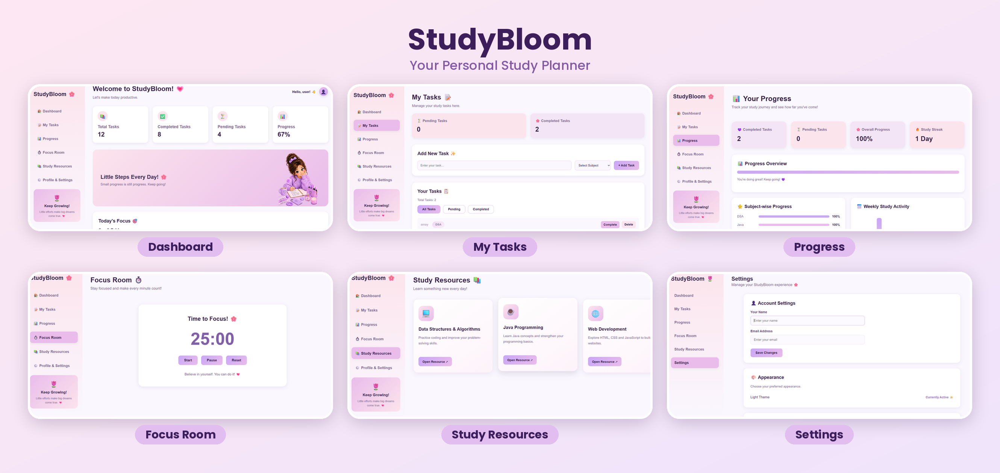

# 🌸 StudyBloom – Your Personal Study Planner

A simple and user-friendly study planner website built to help students organize daily tasks, track progress, manage study time, and stay productive.



---

## 🚀 Live Demo

👉 **[Open StudyBloom](https://studybloom-hub.netlify.app)**

---

## ✨ Features

- 🏠 **Dashboard** – Overview of study activities.
- 📝 **My Tasks** – Add, complete, and delete study tasks.
- 📊 **Progress Tracker** – Track completed and pending tasks, subject-wise progress and weekly activity.
- ⏱️ **Focus Room** – 25-minute focus timer.
- 📚 **Study Resources** – Useful learning resources for DSA, Java, and Web Development.
- ⚙️ **Profile & Settings** – Manage profile and preferences.

---

## 🛠️ Technologies Used

- HTML5
- CSS3
- JavaScript
- LocalStorage
- Netlify (deployment)

---

## 🎨 Design

- Soft pink and lavender theme.
- Simple and clean interface.
- Easy navigation.
- Responsive layout.

---

## 📁 Project Structure

```
StudyBloom/
├── index.html        # Dashboard
├── tasks.html        # My Tasks
├── progress.html     # Progress Tracker
├── focus.html        # Focus Room
├── resources.html    # Study Resources
├── profile.html      # Profile & Settings
├── style.css         # Styling
├── script.js         # JavaScript logic
└── README.md
```

---

## ⚙️ Run Locally

1. Clone the repository
   ```bash
   git clone https://github.com/roshani-dev/StudyBloom.git
   ```
2. Open the project folder
   ```bash
   cd StudyBloom
   ```
3. Open `index.html` in your browser.

---

## 💡 What I Learned

- HTML page structure.
- CSS styling, Flexbox and Grid.
- JavaScript DOM manipulation.
- Event handling and LocalStorage.
- Debugging and problem-solving.
- Building an interactive website from scratch.

---

## 🔮 Future Improvements

- User authentication.
- Backend integration.
- Database connectivity.
- Cloud-based task synchronization.

---

## 👩‍💻 Developed By

**Roshani Srivastava**
Student Developer | Learning, Building & Growing 🚀
GitHub: [@roshani-dev](https://github.com/roshani-dev)

⭐ If you like this project, feel free to explore and share your feedback!

Made with 💗 and lots of learning.
